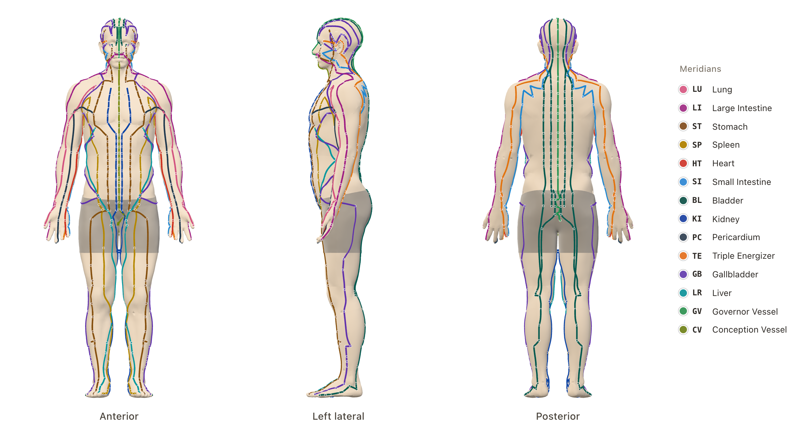
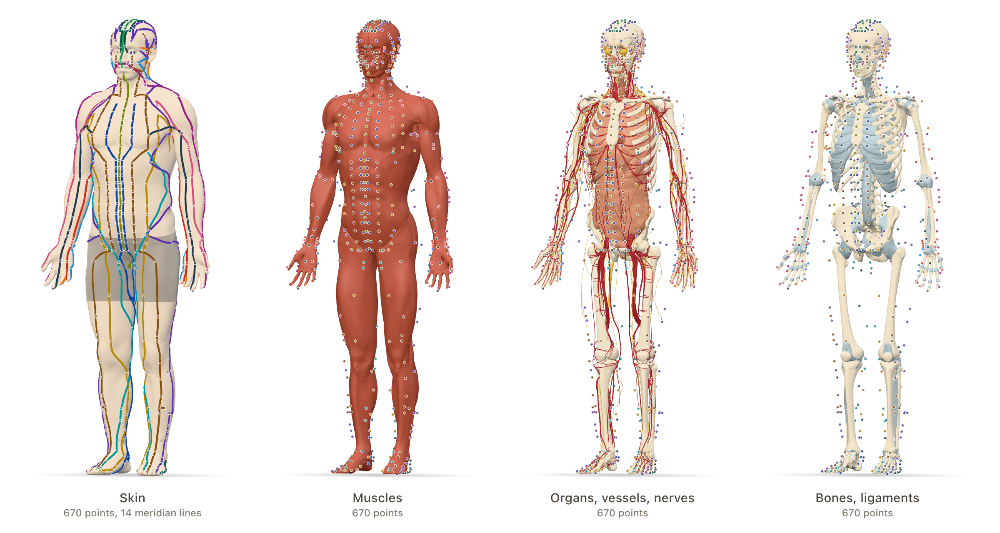
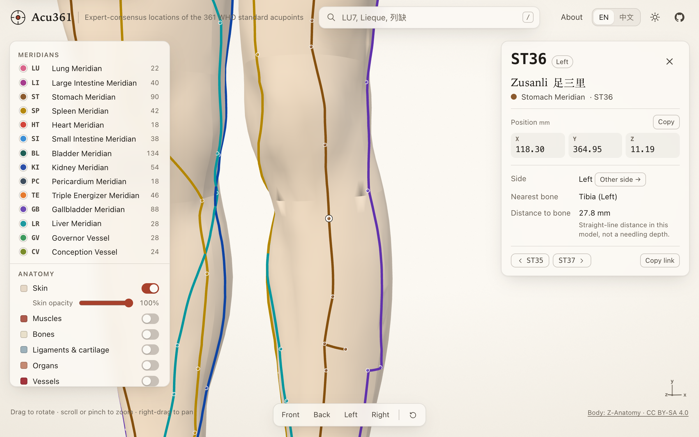

<h1 align="center">Acu361</h1>

<p align="center">
  <b>Precise, expert-consensus locations of the 361 WHO standard acupoints</b>
</p>

<p align="center">
  Yuyue Zhang<sup>1,*</sup>, Timothy G Reese<sup>1</sup>, Yang He<sup>1</sup>, Michael Zhu<sup>1</sup>
</p>

<p align="center">
  <sup>1</sup><a href="https://elwyn921.github.io/lab-website/">Human Motion &amp; Molecular Health Lab</a>, Department of Statistics, Purdue University<br>
  <sup>*</sup>Corresponding author: <a href="mailto:zhan6013@purdue.edu">zhan6013@purdue.edu</a>
</p>

<p align="center">
  <a href="https://elwyn921.github.io/Acu361/"><b>Explore in 3D</b></a> ·
  <a href="#files">Data</a> ·
  <a href="#quick-start">Quick start</a> ·
  <a href="#citation">Cite</a> ·
  <a href="README.zh-CN.md">中文</a>
</p>

<p align="center">
  <a href="LICENSE"></a>
  <a href="LICENSE-CODE"></a>
  
  <a href="https://doi.org/10.5281/zenodo.24448101"></a>
</p>

<p align="center">
  <a href="https://elwyn921.github.io/Acu361/">
    
  </a>
</p>

Acu361 is a precise reference for the locations of the 361 WHO standard acupoints (*WHO Standard Acupuncture Point Locations in the Western Pacific Region*, 2008). A panel of seven acupuncturists went through the points one by one, discussed each, and agreed on a single location for it. Each agreed location is recorded as a millimetre coordinate on the skin of an openly licensed anatomical model, the [Z-Anatomy](https://github.com/Z-Anatomy/Models-of-human-anatomy) male body. The body has seven anatomical layers, so every point can be read against the muscles, bones, vessels and nerves beneath it. The data are released under CC BY-SA 4.0.

You can browse every point in the [online 3D explorer](https://elwyn921.github.io/Acu361/) without installing anything.

## At a glance

| | |
|---|---|
| Locations | Consensus of a panel of seven acupuncturists, reached point by point |
| Acupoints | 361 WHO standard codes, 670 points (309 bilateral codes on both sides, 52 on the midline) |
| Meridians | 14, each with a line drawn over the skin through its points |
| Proportional measurements | 27 B-cun rulers from the WHO standard, measured on the body |
| Body | One adult male, standing, 1709.5 mm tall |
| Anatomy | 7 layers (skin, muscle, bone, ligament, organ, vessel, nerve), 2,812 named structures |
| Units and frame | Millimetres; +x toward the body's left, +y up, +z anterior |
| Formats | JSON, CSV and GLB |

## Figures

<p align="center">
  
</p>

Every point sits on the skin of a body that also has its deeper layers, from muscle down to bone.

<p align="center">
  <a href="https://elwyn921.github.io/Acu361/">
    
  </a>
</p>

The [online explorer](https://elwyn921.github.io/Acu361/): search by code, pinyin or Chinese name, switch layers on and off, and open any point by link.

## Files

| Path | Contents |
|---|---|
| `data/points.json`, `data/points.csv` | The 670 points: code, side, meridian, names, position, nearest bone and distance to it |
| `data/meridians.json` | Surface lines of the 14 meridians (66 segments, sampled about every 4 mm) |
| `data/rulers.json` | The 27 proportional bone measurements with their end points on the body |
| `data/body/*.glb` | The seven anatomical layers of the body |
| `data/manifest.json` | Size and SHA-256 of every data file, counts and the coordinate frame |
| `schema/` | JSON Schema for each JSON file and the conventions used in the GLB files |
| `scripts/validate.py` | Checks the whole package; standard library only |
| `site/` | Source of the online explorer |

Each point looks like this:

```json
{
  "id": "LU7_L",
  "code": "LU7",
  "side": "L",
  "meridian": "LU",
  "index": 7,
  "name_pinyin": "Lieque",
  "name_zh": "列缺",
  "pos": [289.03, 889.26, 12.34],
  "nearest_bone": "Radius.l",
  "bone_distance_mm": 8.6
}
```

`nearest_bone` is the name of a node in `data/body/bone.glb`, so a point can be linked to its bone directly.

## Quick start

Read the points in Python:

```python
import json

points = json.load(open("data/points.json"))["points"]
lu7 = next(p for p in points if p["id"] == "LU7_L")
print(lu7["name_pinyin"], lu7["pos"], lu7["nearest_bone"])
# Lieque [289.03, 889.26, 12.34] Radius.l
```

Or as a table:

```python
import pandas as pd

df = pd.read_csv("data/points.csv")
print(df.groupby("meridian").size())
```

Check that the package is intact:

```bash
python3 scripts/validate.py
```

The script verifies file hashes, the schemas, the point counts per meridian, left-right symmetry, that every point lies on the skin, and that every `nearest_bone` exists in the bone layer. It prints one PASS or FAIL line per check.

## Coordinate frame

All files share one frame. Units are millimetres. The body stands facing +z, with +x toward its own left and +y up; the soles are at y = 0 and the mid-sagittal plane is x = 0. This is the right-handed glTF convention, so the GLB files and the JSON coordinates line up without any transform.

## How the points were located

Each of the 361 acupoints was located by a panel of seven acupuncturists. The panel went through the points one by one. For every point, the members compared where they would place it, discussed the differences, and agreed on a single position. That agreed position was marked on the skin surface of the model in a 3D annotation tool built for this project, and it is the coordinate published here. No point rests on one person's judgment. The members of the panel are not named. Bilateral points are symmetric: each right-side point is the mirror image of its left-side counterpart.

The released coordinates were checked against the body:

- every point lies on the skin surface (median distance 0.005 mm, maximum 0.02 mm);
- left and right points mirror each other to within 0.03 mm;
- all 52 midline points lie within 1.2 mm of the mid-sagittal plane.

The meridian lines were computed from the points. Between consecutive points a line follows the shortest path over the skin, then is smoothed and lifted 1.2 mm off the surface so it renders cleanly.

## Scope and limitations

- The coordinates describe one adult male model. People differ in size and proportion, so using the points on another body requires registration to that body.
- `bone_distance_mm` is the straight-line distance from the skin point to the nearest bone surface in this model. It is a geometric quantity and should not be read as a needling depth.
- The meridian lines join the points over the skin. Internal pathways are not included.
- Proportional measurements are given as straight segments between their two ends, including the ones that follow a curved surface on a real body.
- Acu361 is a reference dataset for research and education. It is not medical advice and does not replace clinical training.

## Citation

If you use Acu361, please cite it:

```bibtex
@misc{acu361,
  title        = {{Acu361}: Precise, Expert-Consensus Locations of the 361 {WHO} Standard Acupoints},
  author       = {Zhang, Yuyue and Reese, Timothy G and He, Yang and Zhu, Michael},
  year         = {2026},
  version      = {1.0.1},
  doi          = {10.5281/zenodo.24448101},
  howpublished = {\url{https://github.com/Elwyn921/Acu361}},
  note         = {Human Motion \& Molecular Health Lab, Department of Statistics, Purdue University}
}
```

GitHub's "Cite this repository" button gives the same reference in other formats from [`CITATION.cff`](CITATION.cff).

## License and attribution

- Data (`data/`, `schema/`): [CC BY-SA 4.0](LICENSE). You may use, share and adapt the data as long as you give credit and release adaptations under the same license.
- Code (`scripts/`, `site/`): [MIT](LICENSE-CODE).

The body is adapted from Z-Anatomy, which is based on BodyParts3D:

- "Z-Anatomy - The libre 3D atlas of anatomy - CC-BY-SA 4.0"
- "BodyParts3D - The Database Center for Life Science - CC-BY-SA 2.1 Japan"

Point codes, the set of 361 points and the proportional measurements follow the WHO standard cited above. [`ATTRIBUTIONS.md`](ATTRIBUTIONS.md) lists the full credits and every change made to the upstream meshes.

## Acknowledgments

We thank the members of the panel.

## Contact

For questions or corrections, open a GitHub issue or email Yuyue Zhang (zhan6013@purdue.edu).

[Human Motion &amp; Molecular Health Lab](https://elwyn921.github.io/lab-website/), Department of Statistics, Purdue University.
