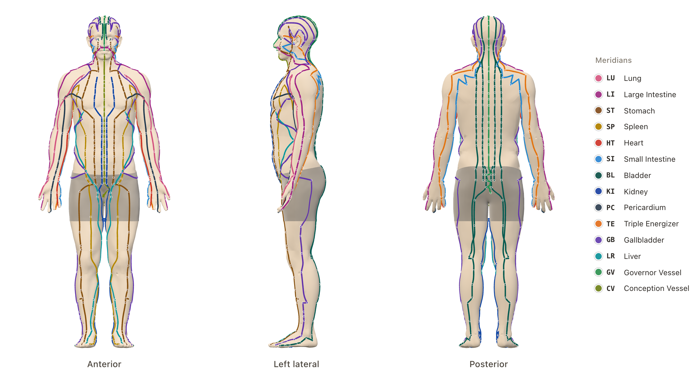
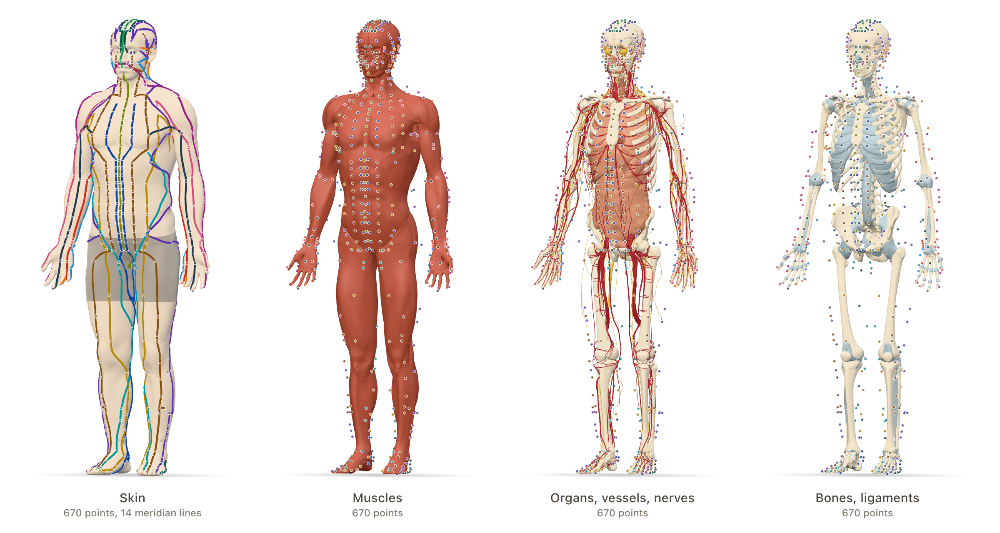
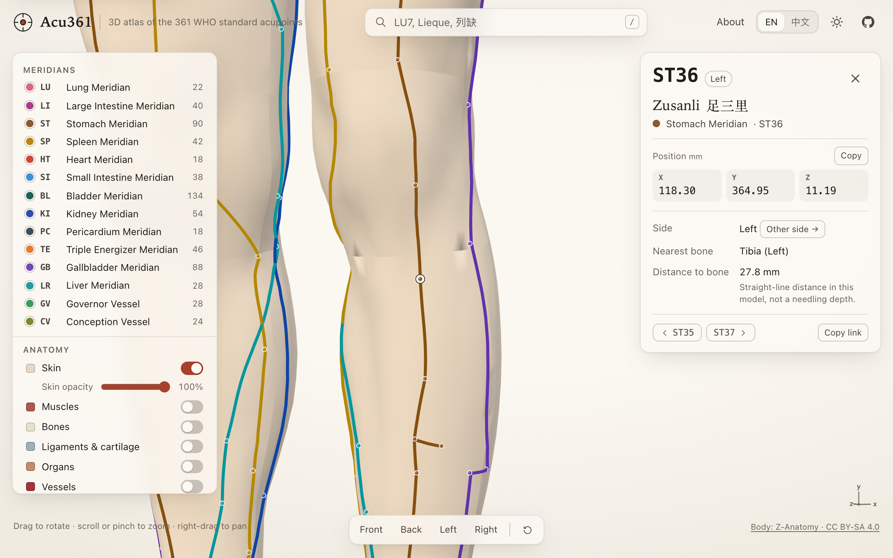

<h1 align="center">Acu361</h1>

<p align="center">
  <b>361 个 WHO 标准经穴的开放三维图谱，由针灸师逐穴标注</b>
</p>

<p align="center">
  Yuyue Zhang<sup>1,*</sup>, Tim Reese<sup>1</sup>, Yang He<sup>1</sup>, Michael Zhu<sup>1</sup>
</p>

<p align="center">
  <sup>1</sup>普渡大学统计系 <a href="https://elwyn921.github.io/lab-website/">Human Motion &amp; Molecular Health Lab</a><br>
  <sup>*</sup>通讯作者：<a href="mailto:zhan6013@purdue.edu">zhan6013@purdue.edu</a>
</p>

<p align="center">
  <a href="https://elwyn921.github.io/Acu361/"><b>在线三维浏览</b></a> ·
  <a href="#文件">数据</a> ·
  <a href="#快速上手">快速上手</a> ·
  <a href="#引用">引用</a> ·
  <a href="README.md">English</a>
</p>

<p align="center">
  <a href="https://elwyn921.github.io/Acu361/">
    
  </a>
</p>

Acu361 是一份穴位三维坐标数据集，收录 WHO 标准（《WHO 西太平洋地区标准针灸穴位定位》，2008）的全部 361 个经穴。每个穴位都由针灸师标在一具开放许可的解剖模型的皮肤上，这具模型是 [Z-Anatomy](https://github.com/Z-Anatomy/Models-of-human-anatomy) 的男性人体。模型带七层解剖结构，所以每个穴位下面是哪块肌肉、哪根骨头、哪条血管和神经，都可以直接对照。坐标单位是毫米，数据以 CC BY-SA 4.0 发布。

不用安装任何东西，打开[在线三维浏览器](https://elwyn921.github.io/Acu361/)就能查看每一个穴位。

## 概览

| | |
|---|---|
| 穴位 | 361 个 WHO 标准穴位码，共 670 个点（309 个双侧穴左右各一，52 个在正中线上） |
| 经脉 | 14 条，每条有一根沿皮肤经过各穴的经线 |
| 骨度分寸 | WHO 标准中的 27 把骨度尺，在这具身体上量出 |
| 身体 | 一名成年男性，立位，身高 1709.5 mm |
| 解剖 | 7 层（皮肤、肌肉、骨、韧带、内脏、血管、神经），2,812 个有名称的结构 |
| 单位与坐标系 | 毫米；+x 指向身体左侧，+y 向上，+z 向前 |
| 格式 | JSON、CSV、GLB |

## 图示

<p align="center">
  
</p>

每个穴位都标在皮肤上，这具身体同时带有从肌肉到骨的深层结构。

<p align="center">
  <a href="https://elwyn921.github.io/Acu361/">
    
  </a>
</p>

[在线浏览器](https://elwyn921.github.io/Acu361/)：按穴位码、拼音或中文名搜索，开关各解剖层，每个穴位都有自己的链接。

## 文件

| 路径 | 内容 |
|---|---|
| `data/points.json`、`data/points.csv` | 670 个点：穴位码、侧别、经脉、名称、位置、最近的骨及到它的距离 |
| `data/meridians.json` | 14 条经脉的体表经线（66 段，约每 4 mm 一个采样点） |
| `data/rulers.json` | 27 把骨度尺及其两端在身体上的位置 |
| `data/body/*.glb` | 身体的七层解剖 |
| `data/manifest.json` | 每个数据文件的大小和 SHA-256、计数、坐标系 |
| `schema/` | 各 JSON 文件的 JSON Schema，以及 GLB 文件的约定 |
| `scripts/validate.py` | 校验整个数据包，只用 Python 标准库 |
| `site/` | 在线浏览器的源码 |

一个点的记录是这样的：

```json
{
  "id": "LU7_L",
  "code": "LU7",
  "side": "L",
  "meridian": "LU",
  "index": 7,
  "name_pinyin": "Lieque",
  "name_zh": "列缺",
  "pos": [289.03, 889.26, 12.34],
  "nearest_bone": "Radius.l",
  "bone_distance_mm": 8.6
}
```

`nearest_bone` 是 `data/body/bone.glb` 里的节点名，可以直接把穴位和对应的骨连起来。

## 快速上手

用 Python 读点：

```python
import json

points = json.load(open("data/points.json"))["points"]
lu7 = next(p for p in points if p["id"] == "LU7_L")
print(lu7["name_pinyin"], lu7["pos"], lu7["nearest_bone"])
# Lieque [289.03, 889.26, 12.34] Radius.l
```

或者读成表格：

```python
import pandas as pd

df = pd.read_csv("data/points.csv")
print(df.groupby("meridian").size())
```

检查数据包是否完整：

```bash
python3 scripts/validate.py
```

脚本会核对文件哈希、schema、各经穴位数、左右对称、每个点是否落在皮肤上、每个 `nearest_bone` 是否存在于骨层，每项检查输出一行 PASS 或 FAIL。

## 坐标系

所有文件用同一个坐标系，单位毫米。人体面朝 +z 站立，+x 指向他自己的左侧，+y 向上；脚底在 y = 0，正中矢状面是 x = 0。这就是 glTF 的右手坐标系，GLB 文件和 JSON 里的坐标不需要任何变换就能对上。

## 穴位是怎么标的

全部 361 个穴位由针灸师（M.Z.）在为本项目开发的三维标注工具里逐穴定位、定稿，直接标在模型的皮肤表面上。双侧穴左右对称：右侧的点是左侧对应点的镜像。

发布的坐标都对着这具身体核对过：

- 每个点都在皮肤表面上（距离中位数 0.005 mm，最大 0.02 mm）；
- 左右两侧的点互为镜像，误差不超过 0.03 mm；
- 52 个中线穴离正中矢状面都不超过 1.2 mm。

经线由穴位计算得到：相邻两穴之间沿皮肤走最短路径，再做平滑，并抬离皮肤 1.2 mm 以便显示。

## 适用范围与局限

- 坐标描述的是一个成年男性模型。人的体型和比例各不相同，把这些点用到另一具身体上需要先做配准。
- `bone_distance_mm` 是皮肤上的点到本模型最近骨面的直线距离，是一个几何量，不能当作进针深度。
- 经线在皮肤上连接各穴，不包含体内循行。
- 骨度分寸以两端之间的直线段给出，在真人身上沿曲面量的那几把也是如此。
- Acu361 是一份用于研究和教学的参考数据，不构成医疗建议，也不能代替临床训练。

## 引用

使用 Acu361 请引用：

```bibtex
@misc{acu361,
  title        = {Acu361: An Open, Expert-Annotated {3D} Atlas of the 361 {WHO} Standard Acupoints},
  author       = {Zhang, Yuyue and Reese, Tim and He, Yang and Zhu, Michael},
  year         = {2026},
  version      = {1.0.0},
  howpublished = {\url{https://github.com/Elwyn921/Acu361}},
  note         = {Human Motion \& Molecular Health Lab, Department of Statistics, Purdue University}
}
```

GitHub 页面上的「Cite this repository」按钮会根据 [`CITATION.cff`](CITATION.cff) 给出其他格式的同一条引用。

## 许可与署名

- 数据（`data/`、`schema/`）：[CC BY-SA 4.0](LICENSE)。可以使用、分享和改编，但要署名，并以同样的许可发布改编后的数据。
- 代码（`scripts/`、`site/`）：[MIT](LICENSE-CODE)。

身体网格改编自 Z-Anatomy，后者基于 BodyParts3D：

- "Z-Anatomy - The libre 3D atlas of anatomy - CC-BY-SA 4.0"
- "BodyParts3D - The Database Center for Life Science - CC-BY-SA 2.1 Japan"

穴位码、361 穴的范围和骨度分寸遵循上面引用的 WHO 标准。完整的署名和对上游网格所做的每一项改动见 [`ATTRIBUTIONS.md`](ATTRIBUTIONS.md)。

## 联系

有问题或勘误，请在 GitHub 提 issue，或发邮件给 Yuyue Zhang（zhan6013@purdue.edu）。

普渡大学统计系 [Human Motion &amp; Molecular Health Lab](https://elwyn921.github.io/lab-website/)。
